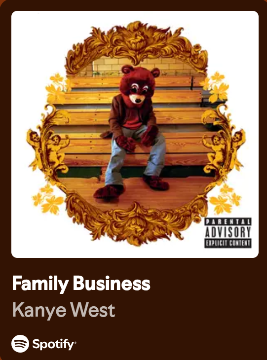

<div align="center">
  <a href="https://discord.com/users/1022221569340227594"></a>
  <a href="https://harmfulladvocado.me"></a>
</div>

<h2 align="center">About Me</h2>

```js
const harmfulladvocado = {
    name: "harmfulladvocado",
    age: 16,
    role: "Full Stack Developer",
    location: "Belgium 🇧🇪",
    interests: ["Privacy", "Open source", "Tech", "Reverse engineering", "Security"],
};
```

<h2 align="center">Languages</h2>

<div align="center">
  
</div>

<h2 align="center">Technologies &amp; Tools</h2>

<div align="center">
  
</div>

<h2 align="center">Github Stats</h2>

<div align="center">
  
  
  
</div>

<h2 align="center">My Favorite Song</h2>

<div align="center">
  <a href="https://open.spotify.com/track/3LpqkEohbTnJ1bvSYNqB3T">
    
  </a>
</div>


